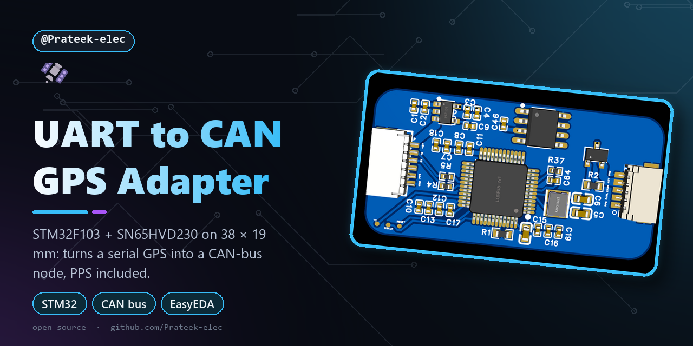
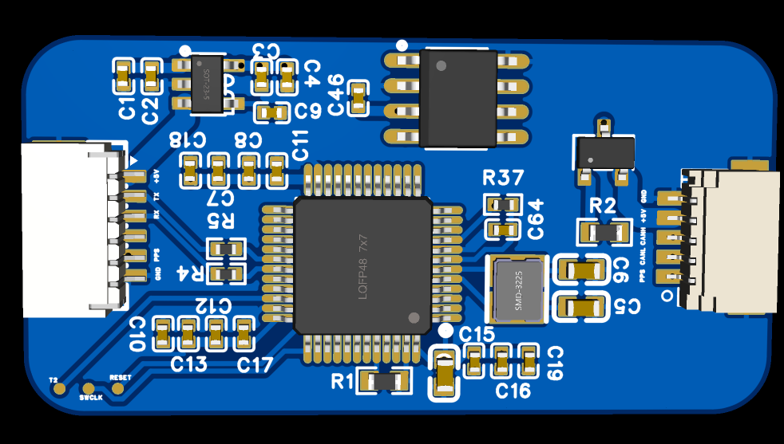
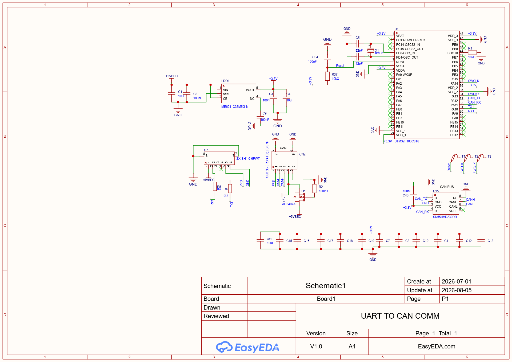
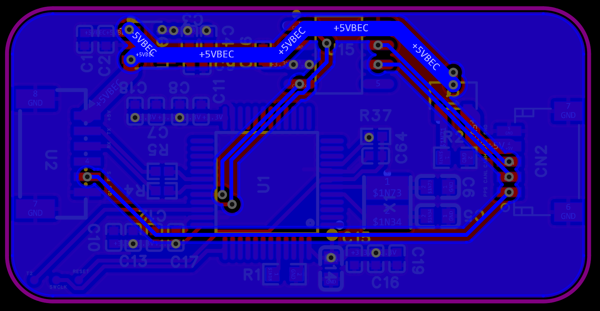

<div align="center">



**A 38 × 19 mm board that puts a serial (UART) GPS on a drone's CAN bus: STM32F103 + SN65HVD230, powered from the bus, with the GPS's PPS timing pulse passed through.**


</div>

---


<sub>3D render: GPS / UART connector on the left, CAN connector on the right, STM32F103 in the middle, CAN transceiver at the top.</sub>

## Why

Modern flight controllers (ArduPilot, PX4) talk to GPS, compass and other peripherals over **CAN / DroneCAN**: one shared, noise-resistant bus instead of a UART per device. Most affordable GPS modules only speak UART. This board sits between them: the GPS plugs into one side, the CAN bus into the other, and a small STM32 translates.

## How it works

```text
            ┌──────────────────────── UART to CAN adapter ────────────────────────┐
 GPS  ──────┤ U2 (JST SH 6-pin)                                 CN2 (JST SH 5-pin) ├────── CAN bus
 +5V  ◄─────┤  +5 V ◄── AO3407A reverse-polarity protection ◄── +5 V                │
 TX   ─────►┤  RX ──► USART1 (PA10)                                                │
 RX   ◄─────┤  TX ◄── USART1 (PA9)      STM32F103C8T6     bxCAN (PA11/PA12) ──► SN65HVD230 ──► CAN-H / CAN-L
 PPS  ─────►┤  PPS ──────────────────────────────────────────────────────────────► PPS
 GND  ──────┤  GND                       ME6211 3.3 V                                GND
            └──────────────────────────────────────────────────────────────────────┘
```

- **Power:** 5 V arrives from the CAN connector, passes the **AO3407A P-MOSFET** (reverse-polarity protection; R2 holds its gate) and powers the GPS. An **ME6211** LDO makes 3.3 V for the STM32 and the transceiver.
- **Brains:** an **STM32F103C8T6** (Cortex-M3, 72 MHz) reads the GPS on **USART1** (PA9 / PA10) and drives the bus with its built-in **CAN controller** (PA11 / PA12). An 8 MHz crystal gives CAN the clock accuracy it needs.
- **Bus:** a **TI SN65HVD230** 3.3 V CAN transceiver, in high-speed mode (Rs to GND), up to 1 Mbit/s.
- **Timing:** the GPS's **PPS** pulse is routed straight through to the CAN connector.
- **Service:** SWD test points (SWDIO, SWCLK, Reset) for programming and debugging; BOOT0 pulled low, NRST pulled up. The 0 Ω links R4 / R5 let TX and RX be swapped or cut.

## Pinout

| U2: GPS / UART (JST SH 6-pin, 1.0 mm) | | CN2: CAN (JST SH 5-pin, 1.0 mm) | |
|---|---|---|---|
| 1 | +5 V out | 1 | PPS |
| 2 | TX: GPS transmit → STM32 RX (PA10) | 2 | CAN-L |
| 3 | RX: GPS receive ← STM32 TX (PA9) | 3 | CAN-H |
| 4 | – | 4 | +5 V in |
| 5 | PPS | 5 | GND |
| 6 | GND | | |

<sub>Pin roles are from the schematic. Check the numbering against your cable before plugging in.</sub>

## Schematic and layout




<sub>2-layer layout: wide +5 V bus on the top, ground pour on both layers. 38 × 19 mm, 3 mm corner radius.</sub>

## Specs

| | |
|---|---|
| **Board** | 38.1 × 19.2 mm, 2 layers, all parts on the top side |
| **Input** | 5 V from the CAN connector, reverse-polarity protected |
| **CAN** | ISO 11898 high-speed, up to 1 Mbit/s (SN65HVD230) |
| **UART** | USART1, 3.3 V logic |
| **MCU** | STM32F103C8T6, 64 KB flash, 20 KB RAM |
| **Parts** | 36, all with LCSC numbers for JLCPCB assembly, see [BOM.csv](BOM.csv) |

## Files

| Path | What it is |
|---|---|
| [`easyeda/uart-to-can-gps-adapter.epro2`](easyeda/uart-to-can-gps-adapter.epro2) | Full EasyEDA Pro project (schematic, PCB, libraries). Open with *File → Open → EasyEDA Pro project* |
| [`BOM.csv`](BOM.csv) | Bill of materials with manufacturer and LCSC part numbers and what each part does |
| [`docs/`](docs/) | Render, schematic and layout images |

## Notes and next steps

- **Firmware isn't included yet.** The hardware suits a DroneCAN GPS node; ArduPilot's [AP_Periph](https://ardupilot.org/dev/docs/ap-periph.html) firmware already runs on STM32F103 GPS boards and is the natural starting point.
- **No CAN terminator on board.** A CAN bus needs 120 Ω at each end; add one externally if this node sits at the end of the bus.
- **Use a 5 V GPS**, or check that your GPS tolerates 5 V supply; the UART lines are 3.3 V logic.

## License

[MIT](LICENSE) © Prateek Sarkar

---

<div align="center">

**If this helps your CAN build, give it a ⭐.** More boards: [github.com/Prateek-elec](https://github.com/Prateek-elec)

</div>
